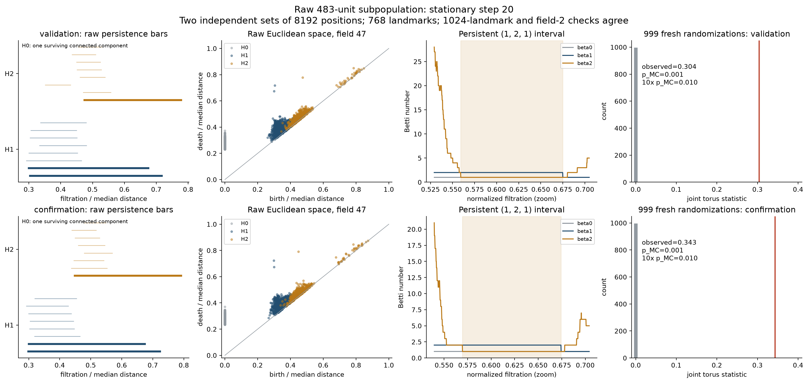

# 人工 RNN 环面拓扑验证 · 第二阶段

**结果范围：公开 Sorscher RNN 的 483 单元子群，在静止输入、20 步终态获得与二维环面一致的原空间持久拓扑证据。随机运动原始状态和全部4096单元整体没有通过同样验收。**

两个独立留出集各8192初位，H0/H1/H2与 `(1,2,1)` 相符；768/1024代表点及域47/2检查一致。原199次检验 Holm p=0.05；999次独立随机化精度复核，两组均无超越，p=0.001，保守十倍校正p=0.01。不是只靠PCA/UMAP图片，也不宣称严格复现Schøyen三环境模型或证明全局数学同胚。



[完整说明](phase2_delivery/README.md) · [方法、失败记录与边界](phase2_delivery/METHODS.md) · [统计表](phase2_delivery/STATISTICAL_SUMMARY.csv) · [全部第二阶段文件](phase2_delivery/)

完整原始数据、模型权重、原训练失败基线、代码、实验协议、随机种子、哈希和科研图均在 `phase2_delivery/`。逐步完整张量为 `H[21,2048,4096]`，固定子群为 `candidate_H[21,2048,483]`。

## 获取全部数据

大文件通过Git LFS直接纳入仓库，没有Release。

```bash
git lfs install
git clone https://github.com/Andante-Assai/neural-manifold-dynamics-phase1.git
cd neural-manifold-dynamics-phase1
git lfs pull
```

本轮未新增长训练；两个公开项目的示例权重相同，不算两个训练种子。已有公开模型提供了条件性的存在证据，原本地缩短训练模型作为失败对照重新封装。

旧第一阶段目录已从当前发布分支移除；历史提交不重写。科研图、交互3D和所有原始分块都可复算。本轮没有拟合测地流或其他几何动力学算子。
